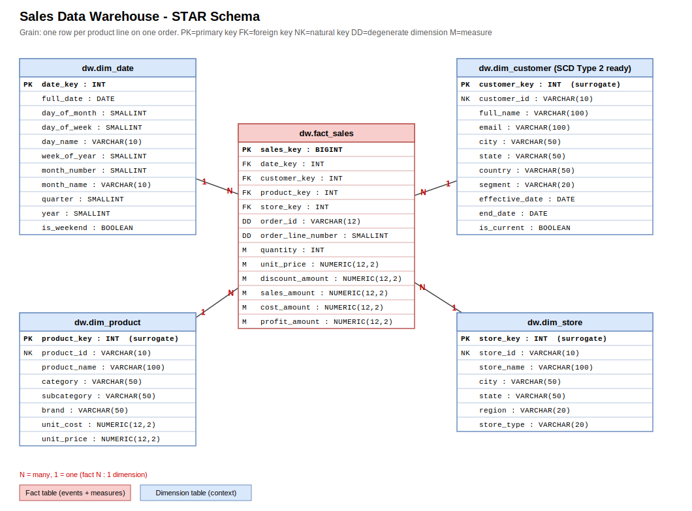
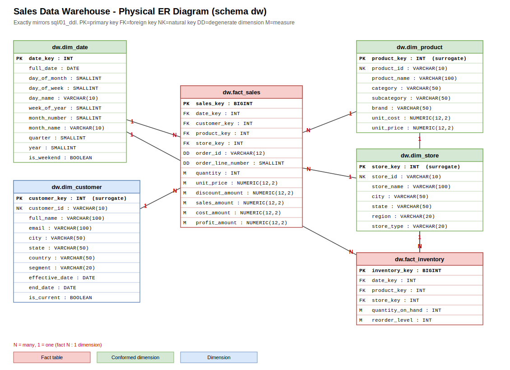

# Sales Data Warehouse - Learning Project

A beginner-friendly, step-by-step data warehouse built with **free tools only**:
**PostgreSQL** (database) - **pgAdmin** (run SQL) - **draw.io** (diagrams) - **GitHub** (store the project). VS Code is optional, for editing files and Git.

You will learn: OLTP vs OLAP, dimensional modeling, star / snowflake / galaxy schemas, facts, dimensions, grain, measures, surrogate vs natural keys, conformed dimensions, and Slowly Changing Dimensions (SCD) Types 1, 2 and 3.

> All SQL in this repo was executed end-to-end on PostgreSQL 16, and the outputs shown in `docs/04_expected_outputs.md` are real.

---
## Project structure
```
dw-sales-project/
|-- README.md                      <- you are here
|-- .gitignore
|-- .vscode/extensions.json        <- optional VS Code extension suggestions
|-- docs/
|   |-- 01_concepts.md             <- OLTP vs OLAP, DW, marts, vocabulary
|   |-- 02_modeling_guide.md       <- design recipe, star/snowflake/galaxy, SCD guide
|   |-- 03_practice_designs.md     <- sales, e-commerce, healthcare designs + exercises
|   |-- 04_expected_outputs.md     <- real output of every script
|-- diagrams/
|   |-- 01_star_schema.drawio      (+ .svg/.png preview)
|   |-- 02_snowflake_schema.drawio (+ .svg/.png)
|   |-- 03_galaxy_schema.drawio    (+ .svg/.png)
|   |-- 04_data_warehouse_erd.drawio (+ .svg/.png)   <- full ER diagram
|-- sql/
|   |-- 00_setup/   01_create_database.sql, 02_create_schemas.sql, 99_reset_everything.sql
|   |-- 01_ddl/     dimensions, fact_sales, snowflake tables, galaxy fact_inventory
|   |-- 02_data/    load dimensions, load facts, load snowflake + galaxy
|   |-- 03_scd/     SCD Type 1, Type 2, Type 3
|   |-- 04_validation/  data-quality checks (everything must say PASS)
|   |-- 05_analytics/   9 business queries
|   |-- run_all.sql                <- optional psql shortcut
|-- tools/make_diagrams.py         <- regenerates the diagrams
```

## The model at a glance


* **Grain:** one row in `fact_sales` = one product line on one order.
* **Dimensions:** `dim_date`, `dim_customer` (SCD2-ready), `dim_product`, `dim_store`.
* **Measures:** quantity, unit_price, discount_amount, sales_amount, cost_amount, profit_amount.
* **Snowflake:** same data, product/store split into sub-tables (`dw_snowflake` schema).
* **Galaxy:** a second fact `fact_inventory` shares the *conformed* date/product/store dimensions.

---
## Setup (one time)
1. Install **PostgreSQL** (free) from <https://www.postgresql.org/download/> - remember the password you set for user `postgres`. pgAdmin 4 is included in the installer.
2. Open **pgAdmin** and connect: *Servers -> PostgreSQL 1x* (enter the password).
3. *(Optional)* Install **VS Code** + recommended extensions (a popup appears when you open the folder): Draw.io Integration, SQLTools (+ PostgreSQL driver), Markdown Mermaid.
4. Get the project: `git clone <your-repo-url>` or unzip the folder, then open it in VS Code (*File -> Open Folder*).

---
## Step-by-step walkthrough (run everything in pgAdmin)

**How to run a file in pgAdmin:** select the database in the left tree -> *Tools -> Query Tool* -> click the folder icon (*Open File*) -> choose the `.sql` file -> press **F5** (or the play button). Check the *Data Output* tab.

| # | Do this | File | You should see |
|---|---|---|---|
| 1 | Connect to database **postgres**, run | `sql/00_setup/01_create_database.sql` | `CREATE DATABASE` OK. Right-click *Databases -> Refresh* |
| 2 | **Open a NEW Query Tool on `sales_dw`** (important!), run | `sql/00_setup/02_create_schemas.sql` | 3 rows: `dw`, `dw_snowflake`, `scd_demo` |
| 3 | Run | `sql/01_ddl/01_create_dimensions.sql` | 4 tables listed |
| 4 | Run | `sql/01_ddl/02_create_fact_sales.sql` | 13 columns listed |
| 5 | Run | `sql/01_ddl/03_create_snowflake_schema.sql` | no error |
| 6 | Run | `sql/01_ddl/04_create_galaxy_fact_inventory.sql` | no error |
| 7 | Run | `sql/02_data/01_load_dimensions.sql` | `730 \| 10 \| 12 \| 4` |
| 8 | Run | `sql/02_data/02_load_fact_sales.sql` | `27 rows, total_sales 776250.00, total_profit 206150.00` |
| 9 | Run | `sql/02_data/03_load_snowflake_and_galaxy.sql` | `27 \| 288` |
| 10 | Run | `sql/04_validation/01_validate_star_schema.sql` | 9 rows, all **PASS** |
| 11 | Run | `sql/05_analytics/01_business_queries.sql` | tip: pgAdmin shows only the *last* result; select one query and press F5 to run it alone |
| 12 | Run the three SCD scripts | `sql/03_scd/01..03_*.sql` | see below |
| 13 | Run | `sql/04_validation/02_validate_scd.sql` | 5 rows, all **PASS** |

> pgAdmin tip: a script with many statements shows only the **last** result grid. To see an earlier result, highlight just that statement and press F5.

Everything is **re-runnable**: tables are dropped/truncated first. To start over completely run `sql/00_setup/99_reset_everything.sql`, then step 2 onwards.

### Command-line alternative (VS Code terminal)
```bash
psql -U postgres -c "CREATE DATABASE sales_dw"
cd sql
psql -U postgres -d sales_dw -f run_all.sql
```

---
## Explain the queries - the important ones

### Loading facts (`02_load_fact_sales.sql`)
Source rows carry **natural keys** (`C001`, `P001`, `S01`, a date). We `JOIN` each dimension to swap them for **surrogate keys**, and compute measures (`sales_amount = qty * price - discount`). This "key lookup" is the heart of every fact load.

### Analytical queries (`05_analytics`)
Pattern: `SELECT dimension columns, SUM(measure) FROM fact JOIN dimensions GROUP BY dimension columns`.

Example - sales by category (Q3):
```sql
SELECT p.category, SUM(f.quantity) AS units_sold,
       SUM(f.sales_amount) AS total_sales, SUM(f.profit_amount) AS total_profit
FROM dw.fact_sales f JOIN dw.dim_product p ON p.product_key = f.product_key
GROUP BY p.category ORDER BY total_sales DESC;
```
```
  category   | units_sold | total_sales | total_profit
-------------+------------+-------------+--------------
 Electronics |         25 |   632900.00 |    148700.00
 Furniture   |         18 |   138400.00 |     54900.00
 Stationery  |         19 |     4950.00 |      2550.00
```

---
## SCD Types 1, 2, 3 - what happens to the same change?
Scenario: a customer changes city.

| | Type 1 (overwrite) | Type 2 (add row) | Type 3 (add column) |
|---|---|---|---|
| Table after | `Surat` | `Ahmedabad` (closed) **and** `Surat` (current) | `current=Surat, previous=Ahmedabad` |
| History | lost | complete | one step |
| Script | `03_scd/01_...` | `03_scd/02_...` | `03_scd/03_...` |

**Type 2 proof** (from the script): Aarav's March order stays under Mumbai, the June order lands under Pune:
```
   city    | total_sales
-----------+-------------
 Ahmedabad |     3000.00
 Mumbai    |     5000.00
 Pune      |     7000.00
```
The trick is the date-range join: `order_date BETWEEN effective_date AND end_date`.

---
## Draw.io diagrams
* Open any `diagrams/*.drawio` at <https://app.diagrams.net> (*File -> Open from -> Device*) or directly in VS Code with the Draw.io extension. Export PNG/SVG via *File -> Export as*.
* To rebuild after changing the model: `python tools/make_diagrams.py`.
* Draw your own: *Arrange -> Insert -> Advanced -> From Text* or the **Entity Relation** shape library.

| Diagram | File |
|---|---|
| Star schema | `diagrams/01_star_schema.drawio` |
| Snowflake schema | `diagrams/02_snowflake_schema.drawio` |
| Galaxy schema | `diagrams/03_galaxy_schema.drawio` |
| Full ER diagram | `diagrams/04_data_warehouse_erd.drawio` |



---
