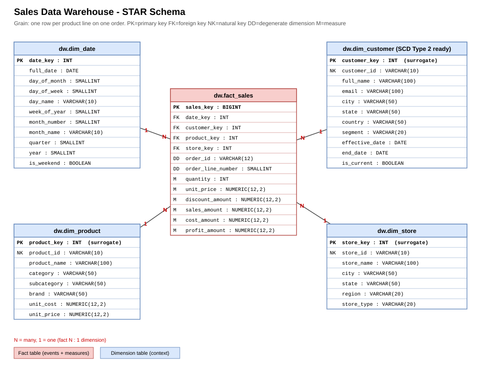
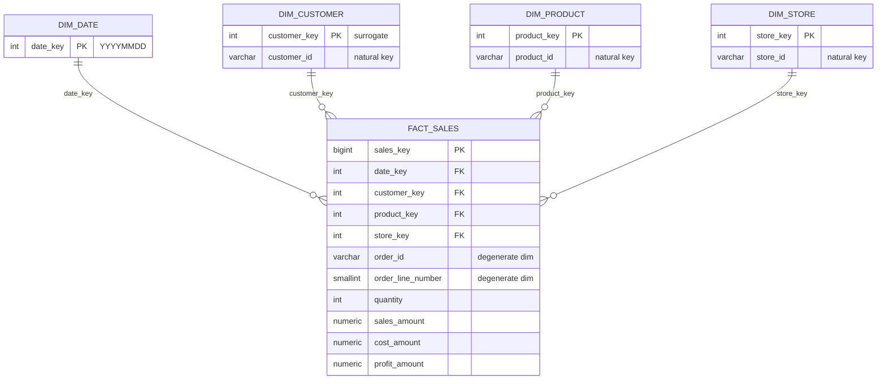

# 02 - Dimensional Modeling Guide

## The 4-step design recipe (Kimball)
1. **Pick the business process** - e.g. *retail sales*.
2. **Declare the grain** - e.g. *one row per product line on one order*. Say it in one sentence **before** anything else.
3. **Choose the dimensions** - who, what, where, when (+ how/why): customer, product, store, date.
4. **Identify the facts (measures)** - quantity, sales amount, cost, profit.

> Golden rule: every measure and every dimension must be true **at the declared grain**.
> If `order_id` is on the fact row, it must make sense per product line - it does.

## Our sales star schema


Open `diagrams/01_star_schema.drawio` in draw.io to edit. The full column-level ERD is `diagrams/04_data_warehouse_erd.drawio`.

Mermaid copy (renders directly on GitHub):


## Star vs Snowflake vs Galaxy

| | Star | Snowflake | Galaxy (fact constellation) |
|---|---|---|---|
| Shape | One fact, flat dimensions | One fact, dimensions split into sub-tables | Several facts sharing dimensions |
| Joins per query | Few (fast, simple) | More (category -> subcategory -> product) | Same as star per fact; extra for drill-across |
| Storage / redundancy | More repeated text | Less | Depends |
| When to use | **Default choice** | Very large/shared hierarchies, strict normalization needs | Several business processes (sales + inventory + returns) |
| In this repo | `dw` schema, diagram 01 | `dw_snowflake` schema, diagram 02 | `dw.fact_inventory` + `dw.fact_sales`, diagram 03 |

* Snowflake diagram: `diagrams/02_snowflake_schema.drawio` - compare query Q3 (1 join) with Q8 (3 joins) in `sql/05_analytics`.
* Galaxy diagram: `diagrams/03_galaxy_schema.drawio` - query Q9 compares sales and stock through **conformed** `dim_date` + `dim_product`.

## Fact table types
| Type | Grain example | In this repo |
|---|---|---|
| Transaction | one row per event | `fact_sales` |
| Periodic snapshot | one row per product/store/month-end | `fact_inventory` |
| Accumulating snapshot | one row per order, updated as it moves through stages | (see e-commerce practice) |

## Slowly Changing Dimensions (SCD)
Customers move, products get re-categorised. What should the warehouse do with the old value?

| Type | Approach | History kept? | Use when | Script |
|---|---|---|---|---|
| **1** | Overwrite | No | Fixing typos/errors, history is irrelevant | `sql/03_scd/01_scd_type1_overwrite.sql` |
| **2** | New row + effective dates + current flag | **Full** | Reports must reflect the truth *at the time* (sales by customer city) | `sql/03_scd/02_scd_type2_history.sql` |
| **3** | Extra column for previous value | Only one step back | Simple before/after comparisons | `sql/03_scd/03_scd_type3_previous_value.sql` |

### Type 2 in one picture
```
customer_key | customer_id | city   | effective_date | end_date   | is_current
1            | C001        | Mumbai | 2025-01-01     | 2026-05-31 | false   <- old facts point here
3            | C001        | Pune   | 2026-06-01     | 9999-12-31 | true    <- new facts point here
```
The fact load finds the right version with a **date-range join**:
`order_date BETWEEN effective_date AND end_date`.

### Common mistakes
* Forgetting the grain -> double counting.
* Using natural keys in the fact table (breaks SCD 2).
* Joining facts to **all** SCD 2 rows instead of by surrogate key.
* Adding a semi-additive measure (stock) across time.
* Using `<>` instead of `IS DISTINCT FROM` for change detection with NULLs.

## Naming conventions used here
`dim_` / `fact_` prefixes, `_key` = surrogate key, `_id` = natural key, plural-free singular table names, snake_case.
