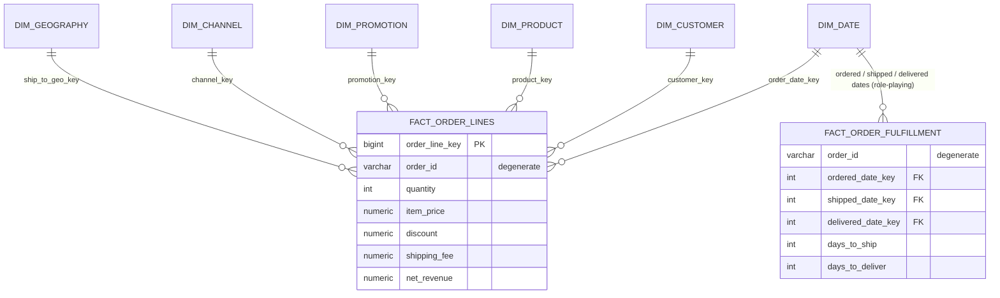
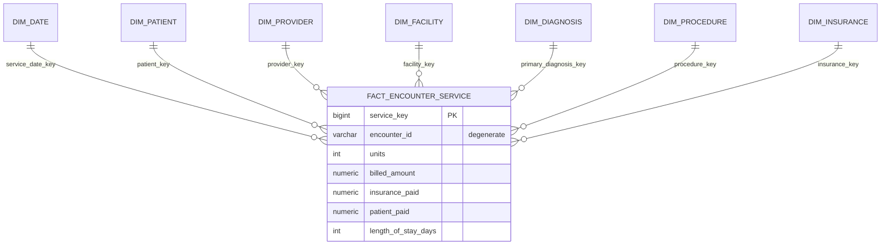

# 03 - Practice Designs: Sales, E-commerce, Healthcare

For each design: **process -> grain -> dimensions -> facts -> SCD choices -> exercises**.
Try to draw each in draw.io (copy `diagrams/01_star_schema.drawio` as a starting point) *before* reading the SQL starter.

---
## A) Sales (already built in this repo)
* **Process:** retail sales   **Grain:** one product line per order
* **Dimensions:** date, customer (SCD2), product, store
* **Facts:** quantity, unit_price, discount_amount, sales_amount, cost_amount, profit_amount
* **Exercises**
  1. Add `dim_promotion` (promo_key, promo_name, discount_pct) and a `promotion_key` FK in `fact_sales`.
  2. Add `fact_returns` (grain: one returned product line) that reuses the conformed dimensions - extend the galaxy.
  3. Apply SCD Type 2 to `dim_product` for `unit_price` changes.
  4. Write a query: *month-over-month growth %* using `LAG()`.

---
## B) E-commerce

**Process:** online orders and their fulfilment.
**Grain (order lines):** one row per product on one order.   **Second fact (accumulating snapshot):** one row per order.


| Part | Design |
|---|---|
| Dimensions | `dim_date` (role-playing: order / ship / delivery date), `dim_customer` (SCD2 for address & loyalty tier), `dim_product` (SCD1 for description fixes, SCD2 for price), `dim_promotion`, `dim_channel` (web, app, marketplace), `dim_geography`, `dim_payment_method` |
| Measures | quantity, item_price, discount, shipping_fee, net_revenue (additive); days_to_ship (accumulating, filled when the stage happens) |
| Factless fact idea | `fact_cart_abandon` - one row per abandoned cart, no measures except count |
| Snowflake idea | product -> subcategory -> category -> department |
| Questions to answer | Conversion by channel? Average days to deliver by region? Revenue by loyalty tier at the time of purchase (needs SCD2)? |

**SQL starter**
```sql
CREATE SCHEMA IF NOT EXISTS ecom;
CREATE TABLE ecom.dim_channel (
    channel_key  INT GENERATED ALWAYS AS IDENTITY PRIMARY KEY,
    channel_name VARCHAR(30) NOT NULL UNIQUE
);
CREATE TABLE ecom.fact_order_lines (
    order_line_key   BIGINT GENERATED ALWAYS AS IDENTITY PRIMARY KEY,
    order_date_key   INT NOT NULL,       -- FK to dim_date
    customer_key     INT NOT NULL,       -- FK to dim_customer (SCD2 version)
    product_key      INT NOT NULL,
    channel_key      INT NOT NULL REFERENCES ecom.dim_channel(channel_key),
    order_id         VARCHAR(12) NOT NULL,
    order_line_no    SMALLINT    NOT NULL,
    quantity         INT NOT NULL CHECK (quantity > 0),
    net_revenue      NUMERIC(12,2) NOT NULL,
    UNIQUE (order_id, order_line_no)
);
```

---
## C) Healthcare

> Use **synthetic (fake) data only**. Real patient data is protected (HIPAA, DPDP Act in India, GDPR) and must never be put in a learning project or on GitHub.

**Process:** patient encounters (visits/admissions) and billing.
**Grain:** one row per procedure/service performed during one encounter.


| Part | Design |
|---|---|
| Dimensions | `dim_date`, `dim_patient` (de-identified; SCD2 for address/insurance, SCD1 for phone correction), `dim_provider` (doctor; SCD2 for department), `dim_facility`, `dim_diagnosis` (ICD-10 code, description, chapter), `dim_procedure` (CPT/ICD-10-PCS), `dim_insurance` |
| Measures | units, billed_amount, insurance_paid, patient_paid (additive); length_of_stay_days (additive per encounter - careful about double counting if the grain is per service!) |
| Bridge table idea | One encounter can have **many diagnoses** -> use `bridge_encounter_diagnosis` with a weighting factor |
| Junk dimension idea | Combine low-cardinality flags (emergency?, admitted?, discharged-home?) into `dim_encounter_flags` |
| Questions to answer | Average length of stay by diagnosis? Readmission within 30 days? Revenue by insurer and month? |

**SQL starter**
```sql
CREATE SCHEMA IF NOT EXISTS health;
CREATE TABLE health.dim_patient (
    patient_key    INT GENERATED ALWAYS AS IDENTITY PRIMARY KEY,
    patient_id     VARCHAR(12) NOT NULL,          -- pseudonymised id, NOT a real name
    gender         CHAR(1),
    birth_year     SMALLINT,                      -- age band instead of full birth date
    city           VARCHAR(50),
    effective_date DATE NOT NULL,
    end_date       DATE NOT NULL DEFAULT DATE '9999-12-31',
    is_current     BOOLEAN NOT NULL DEFAULT TRUE
);
CREATE TABLE health.dim_diagnosis (
    diagnosis_key INT GENERATED ALWAYS AS IDENTITY PRIMARY KEY,
    icd10_code    VARCHAR(8) NOT NULL UNIQUE,     -- e.g. 'E11.9'
    description   VARCHAR(200) NOT NULL,
    chapter       VARCHAR(100)
);
```

---
## How to check your own design (checklist)
- [ ] Grain written as one sentence
- [ ] Every fact column true at that grain
- [ ] Every dimension has a surrogate key + natural key
- [ ] Date handled via `dim_date` (role-playing where needed)
- [ ] SCD type chosen per attribute, with a reason
- [ ] Measures labelled additive / semi-additive / non-additive
- [ ] At least 3 business questions the model can answer
