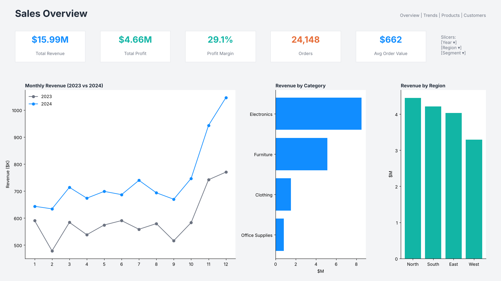
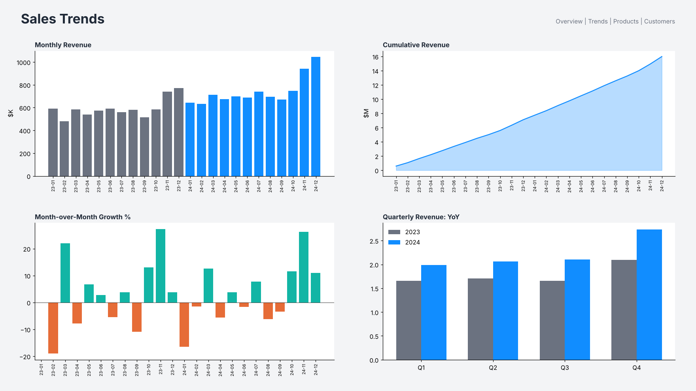
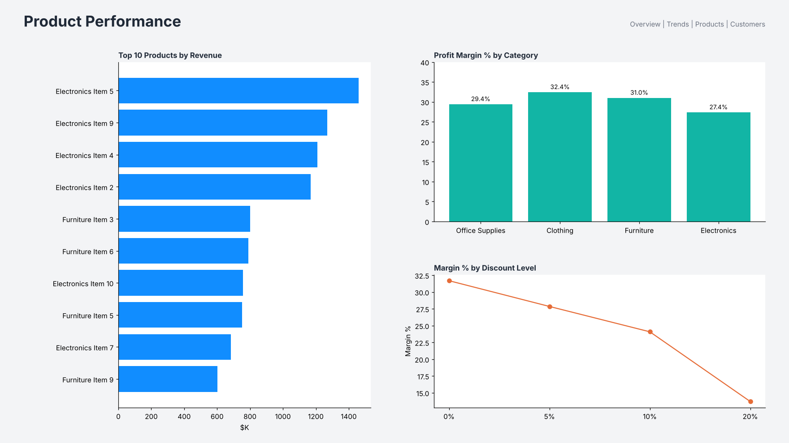
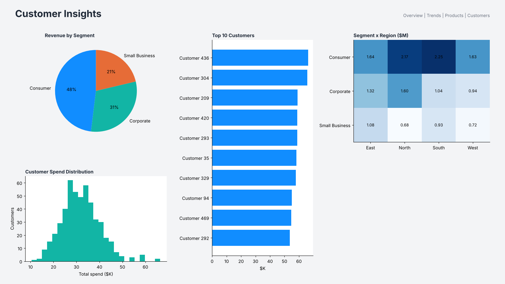

# Day 28: Analytics & Reporting (SQL + Power BI + Python)

Sales analytics project on a star-schema data warehouse.

## Folder structure
```
day28/
├── data/                       warehouse.db (SQLite) + CSVs for Power BI
├── sql/                        analytical queries
│   ├── 01_business_metrics.sql
│   ├── 02_trend_analysis.sql
│   ├── 03_comparative_analysis.sql
│   └── 04_aggregations.sql
├── powerbi/
│   ├── 01_data_model.md        connect + relationships
│   ├── 02_dax_measures.md      all DAX measures
│   ├── 03_dashboard_pages.md   visuals per page
│   ├── 04_dashboard_features.md slicers, drill-through, bookmarks, navigation
│   └── images/                 dashboard page images
├── notebooks/day28_analysis.ipynb   Python analysis
├── insights/insights.md        findings + recommendations
└── scripts/                    data generator, SQL runner, image generator
```

## How to run
```bash
pip install pandas numpy matplotlib seaborn scipy jupyter

python scripts/generate_data.py          # creates data/warehouse.db
python scripts/run_sql.py                # runs all SQL files
python scripts/make_dashboard_images.py  # redraws dashboard images
jupyter notebook notebooks/day28_analysis.ipynb
```
In VS Code: open the folder, install the **Python** and **Jupyter** extensions, and open the `.ipynb` file.

## Dashboard preview

### Overview


### Sales Trends


### Products


### Customers


## Deliverables checklist
- [x] Analytical queries: `sql/`
- [x] Dashboard: build steps in `powerbi/`, preview images in `powerbi/images/`
- [ ] Save your `.pbix` as `powerbi/Day28_Sales_Dashboard.pbix` after building it in Power BI Desktop
- [x] Python notebook: `notebooks/day28_analysis.ipynb`
- [x] Insights document: `insights/insights.md`
