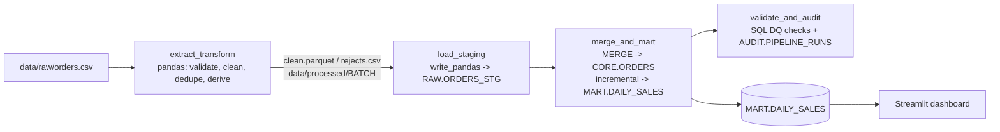

# Architecture

## Purpose
A small, production-style ETL pipeline: daily orders CSV → cleaned data → Snowflake (RAW → CORE → MART) → dashboard.
Orchestrated by **Apache Airflow 2.9 running in Docker**; credentials come from **`.env`** only.

## System diagram

## Components

| Component | Where | Role |
|---|---|---|
| Airflow (webserver, scheduler, Postgres metadata DB) | `docker-compose.yml`, `Dockerfile` | Schedules and retries the DAG; UI on :8080 |
| DAG `orders_etl` | `dags/orders_etl_dag.py` | 4 chained tasks, daily, `max_active_runs=1`, 2 retries with backoff |
| ETL library | `etl/` | extract, transform, quality, load, pipeline (shared by DAG and CLI) |
| SQL | `sql/` | DDL, MERGE, incremental mart refresh |
| Snowflake | RAW / CORE / MART / AUDIT schemas | Warehouse `ETL_WH` (XSMALL, auto-suspend 60s) |
| Dashboard | `dashboard/app.py` | Streamlit on the mart, optional compose profile |

## Layers (Snowflake)

| Schema | Table | Grain | Write pattern |
|---|---|---|---|
| RAW | `ORDERS_STG` | one row per order per batch | append (kept for replay/debug) |
| CORE | `ORDERS` | one row per `order_id` | `MERGE` upsert, only changed rows updated |
| MART | `DAILY_SALES` | date × country × category | delete+insert for affected dates only |
| AUDIT | `PIPELINE_RUNS` | one row per run | append |

## Key design decisions
1. **Tasks pass data via Parquet files, not XCom.** Each task is independently retryable and nothing large goes through the Airflow metadata DB.
2. **Batch ID = Airflow `run_id`** (sanitised). Re-running a batch is idempotent: MERGE on `order_id` with change detection.
3. **Validation before load.** Bad rows never reach Snowflake; they are written to `rejects.csv` with a reason. If rejects exceed 20% of input the run fails before touching Snowflake.
4. **Post-load reconciliation.** Staged row count, key uniqueness/nulls in CORE, and CORE vs MART revenue must agree or the run is marked `DQ_FAILED`.
5. **Credentials only in `.env`** (git-ignored), injected into containers through `env_file`. Nothing secret is in code, SQL or the image.

## Security notes
- `.env` is git-ignored; `.env.example` has placeholders only.
- Use a dedicated Snowflake role with least privilege (USAGE on warehouse/database, CREATE/INSERT/UPDATE/DELETE on the four schemas).
- Batch IDs interpolated into SQL are generated by the pipeline and sanitised to `[A-Za-z0-9_]`; all other values use bind parameters.
- The default Airflow admin password in `.env.example` is for local demos only; change it.

## Limitations (deliberate, for a small pipeline)
- Single CSV file source, no incremental file discovery.
- Password authentication (key-pair auth is recommended beyond demos).
- LocalExecutor on one machine; no HA.
