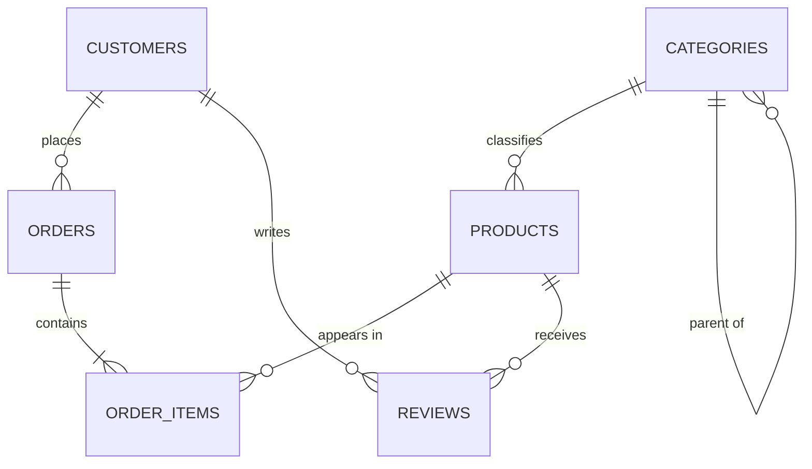

# Day 8 — SQL & PostgreSQL Fundamentals

An e-commerce practice database built in **PostgreSQL** and managed with **DBeaver**.
All scripts were tested end-to-end on PostgreSQL 16 (0 errors).

## Deliverables checklist

| Deliverable | Where |
|---|---|
| PostgreSQL configured | Section 1 below |
| E-commerce database schema | `sql/01_schema.sql` |
| SQL script with 50+ queries | `sql/03_queries_50plus.sql` (**68 queries**) |
| Practice database with data | `sql/02_seed_data.sql` + `sql/ecommerce_practice_backup.sql` |
| README with SQL reference | This file (Section 5) |
| DDL / DML workflows | `sql/04_dml_ddl_workflows.sql` |

## Folder structure

```
day-8-postgresql-final/
├── README.md
└── sql/
    ├── 00_create_database.sql        # CREATE DATABASE
    ├── 01_schema.sql                 # tables, constraints, indexes (DDL)
    ├── 02_seed_data.sql              # 15 customers, 21 products, 20 orders, ...
    ├── 03_queries_50plus.sql         # 68 practice queries (5 sections)
    ├── 04_dml_ddl_workflows.sql      # ALTER, INSERT, UPDATE, DELETE, RETURNING, transactions
    └── ecommerce_practice_backup.sql # full pg_dump (schema + data) for one-step restore
```

---

## 1. PostgreSQL setup

### Install
- **Windows / macOS:** download the installer from <https://www.postgresql.org/download/> (EDB installer).
  Remember the password you set for the `postgres` superuser. Keep port **5432**.
- **Ubuntu/Debian:** `sudo apt install postgresql postgresql-contrib`
- **macOS (Homebrew):** `brew install postgresql@16 && brew services start postgresql@16`

Verify: `psql --version`

### Connect with DBeaver
1. Open DBeaver → **Database → New Database Connection** → choose **PostgreSQL** → Next.
2. Fill in: Host `localhost`, Port `5432`, Database `postgres`, Username `postgres`, Password *(yours)*.
3. DBeaver offers to download the PostgreSQL driver the first time. Click **Download**.
4. Click **Test Connection** → **Finish**.

### Create the practice database
1. Open a SQL editor on the `postgres` connection: **SQL Editor → New SQL script** (Ctrl+]).
2. Run `CREATE DATABASE ecommerce_practice;` (Ctrl+Enter).
3. Right-click **Databases → Refresh**, then edit your connection (F4) → set **Database** to `ecommerce_practice`
   (or enable *Show all databases* on the PostgreSQL tab).

### Load the schema and data
Open each file via **File → Open File**, make sure the active connection is `ecommerce_practice`, then press **Alt+X** (Execute Script):

1. `sql/01_schema.sql`
2. `sql/02_seed_data.sql`

Then run `sql/03_queries_50plus.sql` one query at a time with **Ctrl+Enter**.

**Shortcut:** instead of steps 1–2 you can run `sql/ecommerce_practice_backup.sql` on an empty database.

### Useful DBeaver shortcuts
| Action | Shortcut |
|---|---|
| Run current statement | Ctrl+Enter |
| Run whole script | Alt+X |
| Format SQL | Ctrl+Shift+F |
| Open new SQL script | Ctrl+] |
| Show ER diagram | Right-click database/schema → *View Diagram* |
| Explain plan | Ctrl+Shift+E |

> DBeaver runs in auto-commit mode by default. Scripts here use explicit `BEGIN ... ROLLBACK` blocks so practice data stays intact.

---

## 2. Database design

### Entity-relationship diagram



### Tables

| Table | Purpose | Key constraints |
|---|---|---|
| `customers` | People who buy | PK, `UNIQUE(email)`, `CHECK(loyalty_points >= 0)` |
| `categories` | Product groups (hierarchical) | PK, `UNIQUE(name)`, self-FK `parent_id` |
| `products` | Items for sale | FK→categories, `UNIQUE(sku)`, `CHECK(price > 0)`, `CHECK(price >= cost)`, `CHECK(stock_qty >= 0)` |
| `orders` | One purchase by a customer | FK→customers, `CHECK(status IN (...))` |
| `order_items` | Line items (junction table, many-to-many) | FK→orders (`ON DELETE CASCADE`), FK→products, `UNIQUE(order_id, product_id)` |
| `reviews` | Ratings | FK→products, FK→customers, `CHECK(rating BETWEEN 1 AND 5)`, one review per customer per product |

### Design concepts demonstrated
- **Normalization (3NF):** customers, products and orders are separate; order lines live in `order_items`.
- **Many-to-many** resolved with the `order_items` junction table.
- **`unit_price` copied into `order_items`** so historical orders keep their price when product prices change.
- **Referential actions:** `CASCADE` (delete order → delete its items), `SET NULL` (delete parent category), default `RESTRICT` (cannot delete a product that has been ordered).
- **Identity columns:** `GENERATED ALWAYS AS IDENTITY` (modern replacement for `SERIAL`).

### Indexes
PostgreSQL indexes primary keys and `UNIQUE` columns automatically, but **not foreign keys**, so we add them:

| Index | Type | Why |
|---|---|---|
| `idx_products_category`, `idx_orders_customer`, `idx_order_items_product`, `idx_reviews_product` | B-tree on FK | Fast joins |
| `idx_orders_order_date` | B-tree | Date range filters |
| `idx_products_name_lower` | Expression index on `LOWER(name)` | Case-insensitive search |
| `idx_orders_open` | Partial index (`pending`, `processing`) | Small index for the hot subset |

Check usage with `EXPLAIN ANALYZE` (see Q68). On a 20-row table PostgreSQL may still choose a sequential scan, which is expected; indexes pay off on large tables.

---

## 3. Query script map (`03_queries_50plus.sql`)

| Section | Queries | Topics |
|---|---|---|
| A. SELECT basics | Q1–Q8 | aliases, `DISTINCT`, computed columns, `ROUND` |
| B. Filtering | Q9–Q27 | `= <> < >`, `AND/OR/NOT`, `IN`, `BETWEEN`, `LIKE`, `ILIKE`, `IS NULL`, date ranges |
| C. Sorting & paging | Q28–Q35 | `ORDER BY`, `LIMIT`, `OFFSET`, `NULLS LAST` |
| D. Aggregates | Q36–Q50 | `COUNT SUM AVG MIN MAX`, `GROUP BY`, `HAVING`, `DATE_TRUNC` |
| E. Advanced | Q51–Q68 | joins, subqueries, CTE, `EXISTS`, `CASE`, `COALESCE`, window functions, `EXPLAIN` |

---

## 4. Workflow script map (`04_dml_ddl_workflows.sql`)

1. **ALTER TABLE** — add/rename/retype/drop columns and constraints (inside a rolled-back transaction).
2. **Scratch table** — `CREATE` → bulk `INSERT` → `UPSERT` → `UPDATE ... FROM` → `DELETE ... RETURNING` → `TRUNCATE` → `DROP`.
3. **Place an order** — multi-step transaction using a CTE with `INSERT ... RETURNING`.
4. **Safe deletes** — cascade, FK protection, soft delete.
5. **Constraint violations** — examples that should fail (all verified).

---

## 5. SQL reference

### DDL — structure
```sql
CREATE TABLE t (
    id     INT GENERATED ALWAYS AS IDENTITY PRIMARY KEY,
    name   VARCHAR(50) NOT NULL,
    email  VARCHAR(100) UNIQUE,
    age    INT CHECK (age >= 0),
    status VARCHAR(10) DEFAULT 'active',
    parent INT REFERENCES t(id) ON DELETE SET NULL
);

ALTER TABLE t ADD COLUMN city TEXT;
ALTER TABLE t DROP COLUMN city;
ALTER TABLE t RENAME COLUMN name TO full_name;
ALTER TABLE t ALTER COLUMN age TYPE SMALLINT;
ALTER TABLE t ALTER COLUMN status SET DEFAULT 'new';
ALTER TABLE t ADD CONSTRAINT uq_name UNIQUE (full_name);
ALTER TABLE t DROP CONSTRAINT uq_name;

DROP TABLE IF EXISTS t CASCADE;      -- remove table (CASCADE drops dependents)
TRUNCATE TABLE t RESTART IDENTITY;   -- delete all rows, keep structure

CREATE INDEX idx_name ON t(col);
CREATE UNIQUE INDEX idx_u ON t(col);
CREATE INDEX idx_lower ON t(LOWER(col));          -- expression index
CREATE INDEX idx_part ON t(col) WHERE active;     -- partial index
DROP INDEX idx_name;
```

### Common data types
| Type | Use |
|---|---|
| `INT`, `BIGINT`, `SMALLINT` | whole numbers |
| `NUMERIC(10,2)` | exact decimals (money) |
| `REAL`, `DOUBLE PRECISION` | approximate decimals |
| `VARCHAR(n)`, `TEXT` | strings |
| `BOOLEAN` | true / false |
| `DATE`, `TIMESTAMP`, `TIMESTAMPTZ` | dates and times |
| `JSONB`, `UUID`, `ARRAY` | PostgreSQL extras |

### Constraints
| Constraint | Meaning |
|---|---|
| `PRIMARY KEY` | unique + not null row identifier |
| `FOREIGN KEY ... REFERENCES` | value must exist in another table |
| `UNIQUE` | no duplicates (NULLs allowed) |
| `NOT NULL` | value required |
| `CHECK (expr)` | custom rule |
| `DEFAULT value` | value used when omitted |

### DML — data
```sql
-- INSERT
INSERT INTO t (a, b) VALUES (1, 'x');                       -- single
INSERT INTO t (a, b) VALUES (1,'x'), (2,'y'), (3,'z');      -- bulk
INSERT INTO t (a, b) SELECT a, b FROM other;                -- from query
INSERT INTO t (a, b) VALUES (1,'x') RETURNING id;           -- get generated id
INSERT INTO t (id, b) VALUES (1,'x')
  ON CONFLICT (id) DO UPDATE SET b = EXCLUDED.b;            -- upsert

-- SELECT
SELECT col1, col2 AS alias FROM t WHERE cond ORDER BY col1 DESC LIMIT 10 OFFSET 20;

-- UPDATE
UPDATE t SET a = a + 1, b = 'new' WHERE id = 5 RETURNING *;

-- DELETE
DELETE FROM t WHERE id = 5 RETURNING *;
```
> **Always** include `WHERE` on `UPDATE` and `DELETE`. Test with a `SELECT` using the same `WHERE` first.

### WHERE operators
| Operator | Example |
|---|---|
| `= <> != < > <= >=` | `price >= 100` |
| `AND OR NOT` | `a > 1 AND (b = 2 OR c = 3)` |
| `IN (...)` / `NOT IN` | `city IN ('Pune','Delhi')` |
| `BETWEEN x AND y` (inclusive) | `price BETWEEN 10 AND 50` |
| `LIKE` (case-sensitive) | `name LIKE 'A%'` |
| `ILIKE` (case-insensitive, PostgreSQL) | `name ILIKE '%phone%'` |
| `IS NULL` / `IS NOT NULL` | `phone IS NULL` (never `= NULL`) |

**LIKE wildcards:** `%` = any number of characters, `_` = exactly one character.

### Sorting, limiting, distinct
```sql
SELECT DISTINCT city FROM customers;
SELECT * FROM products ORDER BY price DESC, name ASC;
SELECT * FROM products ORDER BY price DESC LIMIT 5;        -- top 5
SELECT * FROM products ORDER BY id LIMIT 10 OFFSET 20;     -- page 3
SELECT * FROM customers ORDER BY phone NULLS LAST;
```

### Aggregates
| Function | Result |
|---|---|
| `COUNT(*)` | number of rows |
| `COUNT(col)` | non-NULL values |
| `COUNT(DISTINCT col)` | unique non-NULL values |
| `SUM(col)`, `AVG(col)` | total, mean |
| `MIN(col)`, `MAX(col)` | smallest, largest |

```sql
SELECT category_id, COUNT(*), AVG(price)
FROM products
WHERE is_available               -- filters ROWS before grouping
GROUP BY category_id
HAVING COUNT(*) > 2;             -- filters GROUPS after aggregation
```
**Order of execution:** `FROM → WHERE → GROUP BY → HAVING → SELECT → DISTINCT → ORDER BY → LIMIT`

### Joins
```sql
SELECT ... FROM a INNER JOIN b ON a.id = b.a_id;   -- only matching rows
SELECT ... FROM a LEFT  JOIN b ON a.id = b.a_id;   -- all of a, matches from b
SELECT ... FROM a RIGHT JOIN b ON a.id = b.a_id;   -- all of b
SELECT ... FROM a FULL  JOIN b ON a.id = b.a_id;   -- everything
-- Rows in a with NO match in b:
SELECT a.* FROM a LEFT JOIN b ON a.id = b.a_id WHERE b.a_id IS NULL;
```

### Handy functions
| Category | Functions |
|---|---|
| Text | `UPPER LOWER LENGTH TRIM SUBSTRING CONCAT` and `\|\|` |
| Numeric | `ROUND(x,2) CEIL FLOOR ABS` |
| Date | `NOW() CURRENT_DATE DATE_TRUNC('month', d) EXTRACT(YEAR FROM d)` |
| NULL | `COALESCE(x, default)  NULLIF(a, b)` |
| Conditional | `CASE WHEN ... THEN ... ELSE ... END` |
| Cast | `col::INT`  or  `CAST(col AS INT)` |

### Transactions
```sql
BEGIN;
UPDATE accounts SET bal = bal - 100 WHERE id = 1;
UPDATE accounts SET bal = bal + 100 WHERE id = 2;
COMMIT;      -- or ROLLBACK; to undo everything
```

### psql / DBeaver metadata helpers
```sql
SELECT table_name FROM information_schema.tables WHERE table_schema = 'public';
SELECT column_name, data_type, is_nullable
FROM information_schema.columns WHERE table_name = 'products';
EXPLAIN ANALYZE SELECT ...;
```
In `psql`: `\l` list databases, `\c db` connect, `\dt` list tables, `\d table` describe, `\q` quit.

---

## 6. Practice ideas (to go beyond 68 queries)
- Which customers bought products from **every** category?
- Month-over-month revenue growth using `LAG()`.
- Find products whose average rating is below the average of all products.
- Add a `coupons` table and write the foreign-key relationship to `orders`.
- Create a view `v_order_summary` joining orders, customers and items.
